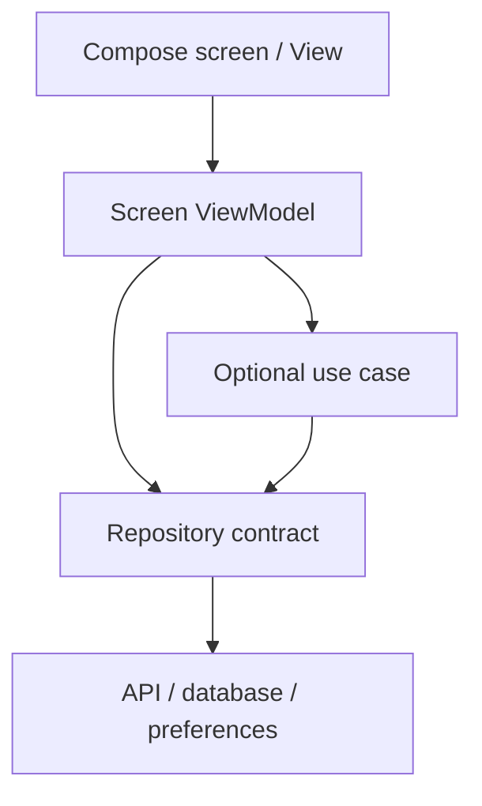

# Android App Architecture Standard for Codex

**Purpose:** A reusable specification for building native Android apps and incrementally refactoring existing ones.  
**Audience:** Codex or another implementation agent, plus the engineer reviewing its work.  
**Baseline:** Kotlin, Jetpack Compose for new UI, Android Jetpack, Gradle.  
**Updated:** 18 November 2026.  
**Status:** Default architecture, not a command to rewrite an existing application.

> **How to use this document:** Give Codex this file with a product brief or repository. For a new app, follow Sections 1–14 and the new-app instructions in Section 15. For an existing app, first follow the inspection and migration instructions in Section 16. Product requirements, repository constraints, and explicit user instructions take precedence over these defaults. Do not implement an unspecified feature merely because this document mentions it.

## 1. Goals and decision rules

The architecture must make features understandable, changeable, and independently testable; keep UI separate from data access; support runtime configuration safely; and allow gradual evolution. Optimize for a working product and clear boundaries, not the maximum number of layers or Gradle projects.

Before implementation, identify: target users and devices; minimum and target SDK; distribution channel; existing code and backend contracts; authentication; offline expectations; sensitive data; localization; accessibility; performance targets; release process; team size; and which behaviors truly need to change without a store release. Record unknowns and make small, reversible assumptions. Do not invent API schemas, authentication behavior, or business rules.

Use these defaults unless project evidence calls for something different:

| Concern | Default | Change the default when |
|---|---|---|
| Language | Kotlin | Existing Java code should stay Java during unrelated work; migrate selectively. |
| New UI | Jetpack Compose and Material 3 | Existing Views/XML screens are stable, or project design requires interop. |
| Presentation | Screen-level ViewModel, immutable UI state, unidirectional events | A trivial reusable component needs only local Compose state. |
| Data access | Repository per coherent data capability | A tiny prototype still gets a clear data boundary, even if in one module. |
| Domain/use cases | Add for complex or reused operations | Simple one-to-one reads can go from ViewModel to repository. |
| Async | Coroutines and Flow | An established codebase uses another approach; migrate at boundaries. |
| Injection | Hilt for a nontrivial new app; constructor injection inside classes | A small app can use manual injection; an existing DI framework can remain. |
| Persistence | Room for structured relational local data; DataStore for small preferences | Use another fit-for-purpose store when requirements justify it. |
| Background work | WorkManager for deferrable persistent work | Use platform or task-specific APIs for foreground, exact-time, or immediate work. |
| Navigation | One app-owned navigation coordinator; feature-owned destinations/contracts | Preserve an existing navigation stack during incremental migration. |
| Dynamic behavior | Typed configuration plus backend data and feature flags | Do not introduce remote configuration without a concrete requirement. |
| Modules | Organize by feature; add Gradle modules at useful ownership boundaries | Small apps may start with packages in one app module. |

These are defaults, not a dependency shopping list. Select actual library versions from the repository's version catalog or current compatible stable releases when implementing. Do not copy versions from this document into a future project.

## 2. Three different meanings of “dynamic”

Do not confuse these mechanisms:

1. **Modular code:** Gradle modules and package boundaries make development and refactoring easier. A normal feature module is still shipped with the app.
2. **Runtime configuration:** A server or remote-config provider supplies values for flags, copy, ordering, thresholds, themes, or offers supported by code already installed. No new executable capability is created by a flag.
3. **On-demand delivery:** Play Feature Delivery installs a packaged dynamic feature module after initial installation. This reduces initial size for a suitable optional feature, but adds installation, loading, and failure handling. It is not a replacement for a maintainable source structure or a mechanism for instant arbitrary code changes.

Choose each independently. A modular app can ship all features at install time. A single feature can have configuration. Use Play delivery only if distribution and measured feature usage or app size justify it.

## 3. Layers and flow



The UI renders state and sends user actions upward. The ViewModel coordinates a screen, exposes state, and invokes repository or use-case operations. A use case expresses meaningful business logic that is complicated or shared. A repository owns the application-facing data contract and coordinates local and remote data sources. Data sources know the details of HTTP, SQL, files, or platform services. Navigation and Android lifecycle belong at the boundaries.

**A typical interaction:** the user taps Refresh → the screen invokes `viewModel.refresh()` → the ViewModel asks a repository to refresh → the repository fetches and validates remote data and updates local storage if appropriate → a Flow emits the new model → the ViewModel maps it to `UiState` → Compose renders. For a noncached feature, the repository can return the result directly; do not create a database merely to reproduce this flow.

**Boundary rules:**

- Composables do not call HTTP clients, DAOs, or SDK services directly.
- ViewModels do not depend on Retrofit service types, database entities, or concrete persistence details.
- DTOs and database entities do not become UI models by accident. Map at a boundary when formats or lifecycles differ.
- Keep Android `Context` out of pure business logic where possible. Inject a narrow capability if it is genuinely needed.
- No module bypasses a feature's public contract to reuse an internal ViewModel, DAO, or screen.
- Keep business invariants on the authoritative backend as well as in the client UX. Client visibility flags are never authorization.

## 4. Project and module structure

### 4.1 Recommended starting structure for a growing app

```text
root/
  app/                    Application, entry Activity, composition, app navigation
  core/
    model/                Truly shared application models; Android-free if possible
    designsystem/         Theme, tokens, reusable UI components
    common/               Small shared utilities only when genuinely shared
    network/              HTTP setup, authentication transport, serialization
    database/             Database setup and migrations, if needed
    configuration/        Typed configuration access and defaults, if needed
    testing/              Reusable fakes/test helpers, test scope only
  data/
    account/              Account repository, mapping, data sources
    orders/               Orders repository, mapping, data sources
  feature/
    account/              Account screen(s), state, ViewModel, navigation entry
    orders/               Orders screen(s), state, ViewModel, navigation entry
  build-logic/             Convention plugins only after repeated build setup warrants them
```

Example module names: `:app`, `:core:model`, `:core:designsystem`, `:data:orders`, `:feature:orders`. These are examples, not modules to create for every app. If there are two screens and one developer, packages such as `feature/orders` and `data/orders` inside `:app` may be sufficient. Extract a Gradle module when it gives a real benefit: ownership, dependency enforcement, reuse, isolated build/test scope, or Play delivery.

### 4.2 Dependency direction

- `:app` composes features, binds implementations, and owns the top-level navigation graph. It may depend on feature and data implementation modules.
- A feature depends on only the data contracts and shared capabilities it uses. It must not depend on another feature's implementation.
- Data implementation depends on its own repository contract, relevant models, and infrastructure. Infrastructure modules do not depend on features.
- Shared modules should be small and stable. Never put unrelated feature logic into `:core:common` merely to avoid choosing an owner.
- Prefer Gradle `implementation` to `api`; expose only the types consumers need.
- Keep the graph acyclic. If A and B need each other, extract a narrow contract or move the shared behavior to its proper owner.

**Contract placement:** A simple app may keep a public `OrdersRepository` interface in `:data:orders` with internal implementation details. If compile-time isolation or swappable implementations matter, split it into `:data:orders:api` and `:data:orders:impl`, and bind the implementation in the composition root. Do this only when the split pays for itself. The domain layer is a *logical* layer and need not be a separate Gradle module.

### 4.3 Feature definition

Each feature owns its screens, screen state, ViewModels, feature-specific UI components, and navigation entry. Its data contract is explicit. It accepts IDs or small route arguments, then loads current data through its repository. Avoid passing large mutable objects between screens. Shared design components belong in the design system once there are real consumers; feature-specific components stay in the feature.

## 5. UI and state management

Use a clear state model for each screen, such as `Loading`, `Content`, `Empty`, and `Error`, or a data class when loading and content can coexist. Represent retry, refreshing, validation, and operation progress explicitly when the UI needs them. Keep state immutable from the UI's perspective. Events flow from UI to ViewModel; state flows back to UI.

- A route composable obtains the ViewModel and collects state with lifecycle awareness. Pass plain state and callbacks to a reusable screen composable so it can preview and test without a ViewModel.
- Keep purely visual, short-lived state (for example, an expanded card) local with `remember` or `rememberSaveable` as appropriate. Put state affected by business logic or shared across screens in the relevant state holder.
- Do not store an Activity, View, NavController, or composable lambda in a ViewModel. Emit state or effects and let UI perform UI navigation or platform presentation.
- Make one-off effects explicit where needed; do not repeatedly navigate or show a snackbar because a persistent state is recollected. Prefer durable state for outcomes the user should still see after recreation.
- Design loading, empty, offline, stale, permission-denied, validation, and retry experiences according to the product. Avoid showing a blank screen on failure.
- Keep recomposition cheap: stable keys for lists, sensible state granularity, no network calls or expensive parsing in composables. Measure before optimizing.
- Support accessibility labels, text scaling, contrast, touch targets, RTL, and locale-specific formatting. Store data in neutral types, not preformatted display strings.

## 6. Data, networking, and persistence

Define repository operations from product needs: `observeOrders()`, `refreshOrders()`, `submitOrder(command)`, rather than exposing `getOrdersDao()` or a raw HTTP response. Keep transport models (`OrderDto`), storage models (`OrderEntity`), and application models (`Order`) separate when they differ; validate and map at the owning data boundary.

**Network:** centralize client configuration, base URL per environment, timeouts, authentication headers, serialization, redacted logging, and error mapping. Distinguish transport failure, server rejection, authentication expiration, and malformed responses. Do not silently treat all failures as an empty list. Use cancellation-aware coroutine code and do not block the main thread. Keep credentials and API secrets out of source control and app binaries where a secret must actually remain secret.

**Persistence:** use Room for queryable structured local data and migrations; use DataStore for small settings. Define cache lifetime, invalidation, refresh triggers, ownership, and logout cleanup. Do not add persistent storage without a reason. Avoid changing database schemas without a tested migration path and a plan for existing installed versions.

**Offline behavior is a product decision:**

- **Online required:** show useful connection and retry state. Do not claim offline support.
- **Read offline:** cache suitable data and mark stale content if material.
- **Write offline:** define a durable operation queue, idempotency key, ordering, conflict resolution, authentication expiry, retry/backoff, and user-visible pending/failed status. Use WorkManager for persistent deferrable synchronization where appropriate.
- For a deliberate offline-first design, a local data source can be the client source of truth, while the server remains authoritative for shared business state. Specify exactly how they reconcile.

For pagination, establish stable IDs, ordering, invalidation, and whether cached and network pages may mix. Use Paging when the dataset and UX warrant it. For financial or otherwise sensitive operations, server calculations and final status are authoritative; never infer success merely from a local optimistic update.

## 7. Dependency injection and cross-cutting services

Prefer constructor injection. In a nontrivial new Android app, Hilt can assemble ViewModels, repositories, clients, and platform dependencies. Bind each contract to one implementation in the appropriate scope. Do not create a global service locator or put all dependencies in `Application`. Keep scopes no broader than necessary; a singleton ViewModel is usually a design error.

Define narrow interfaces where they improve testing or isolate a volatile service: `FeatureFlagProvider`, `SessionStore`, `Clock`, `ConnectivityObserver`, or `OrdersRepository`. Do not create an interface for every data class or one-line helper. Keep logging, analytics, crash reporting, and consent behind defined boundaries; prevent sensitive payloads from entering logs or telemetry.

## 8. Navigation and feature boundaries

The application owns entry points, authentication gating, deep-link routing, and the top-level graph. Each feature exposes its destination or route registration through a small public entry, while keeping screen internals private. Choose one navigation stack suitable for the app and preserve it during unrelated refactors; do not mix multiple routing systems without an interop plan.

Use typed route arguments or a well-defined serialized contract, with stable IDs rather than full objects. Validate external deep links, authorization, and malformed arguments. Restore state after process death where required. Handle back navigation, nested flows, and tab state deliberately. A feature's navigation API should describe destinations, not reveal its internal screen tree to other features.

## 9. Runtime configuration and dynamic UI

Remote configuration is optional. When the product needs it, define a **typed configuration contract** in the app with built-in defaults. Record each field's owner, type, valid range, fallback, cache/refresh policy, and effect. For example, `showNewCheckout: Boolean`, `homeBanner: BannerConfig?`, or `maxVisibleOffers: Int` with a bounded range.

**Configuration pipeline:** fetch → parse → validate → select supported version → atomically activate → expose a typed snapshot to consumers. Persist the last known good value if useful. On timeout, malformed content, unsupported version, or partial rollout, use a safe default or last known good configuration. Never let malformed remote values crash app startup. Avoid changing a form or checkout midway through a user action; activate at a deliberate boundary.

**Feature flags:** give flags clear names, owners, expiry/review dates, rollout criteria, and cleanup plans. Test both enabled and disabled paths. Include a kill switch for risky features when the operational need is real. A client flag may hide an action, but the backend must still enforce eligibility, price, permissions, and access control. Remote Config or a backend endpoint can provide flags; choose based on targeting, operational needs, and existing infrastructure.

**Server-driven UI:** use it only when the product explicitly needs variable composition without an app release. Define a versioned, constrained schema such as `screen -> sections -> known component types -> validated properties`. The installed app renders only supported components and actions. Validate types, lengths, URLs, identifiers, localization, and accessibility text; provide fallback UI for unknown optional components and reject unsupported critical flows. Cache and test schema versions. Keep business transactions and permission decisions server-side. Do not turn arbitrary server JSON into an uncontrolled execution language.

**On-demand modules:** if using Play Feature Delivery, define when installation starts, progress/cancel/error UI, network requirement, retry, navigation after install, and behavior when the module is absent. Confirm the target distribution channel supports the chosen delivery path. Do not make a core first-run journey depend on a fragile late download without a reason.

## 10. Security, privacy, and reliability

- Use HTTPS and platform-supported authentication patterns. Keep tokens in an appropriate protected store and define refresh, expiration, logout, and account-switch behavior. Do not place credentials in logs, URLs, or analytics.
- Validate all external input: deep links, remote configuration, server data, files, and intents. Treat the client as untrusted from the server's perspective.
- Request only necessary permissions at the moment they are useful; handle denial and revocation. Minimize collected data and retention.
- Define timeout, retry, backoff, and idempotency by operation. Automatic retries must not duplicate purchases or submissions. Separate retryable transport errors from business rejection.
- Keep network, file, database, and CPU-heavy work off the main thread. Handle cancellation, process death, app update, and version mismatch.
- Set observability around meaningful failures and performance without logging personal or secret content. Tie crash reports to app version and feature rollout where available.
- For high-impact data such as payments or medical information, add domain-specific safeguards and review before launch; this general document is not a substitute for product security requirements.

## 11. Build and dependency management

Use the repository's Gradle wrapper and version catalog if present. Pin compatible dependencies and update intentionally. Keep `namespace`, application ID, flavors, build types, signing, and min/target SDK distinct. Separate development, staging, and production endpoints without shipping production credentials in a debug build or debug-only behavior in release.

If repeated Gradle configuration appears across modules, introduce convention plugins in `build-logic` with clear ownership. Avoid premature build tooling. Check module dependency direction and Gradle configuration time before adding more modules. Keep generated files, signing keys, and local secrets out of version control. Build reproducibly in CI with the wrapper.

## 12. Testing strategy and acceptance gates

Test behavior at the cheapest meaningful level; do not mirror implementation line for line.

| Level | Prove |
|---|---|
| Pure logic | Parsing, mapping, validation, calculation, use-case invariants. |
| Repository | Success/error/cancellation paths, cache and refresh policy, synchronization conflicts if supported. |
| ViewModel | State transitions for load, retry, submit, empty, and failure using fakes and controlled dispatchers. |
| UI | Key user journeys, accessibility semantics, navigation, state restoration, and critical visual states. |
| Integration | Real serialization, database migrations, dependency wiring, backend contract assumptions where feasible. |

Include tests for flag on/off and invalid/stale config where configuration drives a critical path. For offline write support, test duplicate requests, delayed sync, conflicting updates, and logout. Preserve regression tests for existing behavior before changing it. Avoid asserting private method calls when observable results are more robust.

Before declaring completion, run the relevant existing build, unit tests, lint, and targeted UI/instrumented tests when their environment is available. Example tasks might be `./gradlew :app:assembleDebug`, `./gradlew testDebugUnitTest`, and `./gradlew lintDebug`; inspect available modules and variants before using these exact commands. Report what actually ran, what passed, what failed, and what could not run. Do not say “tested” if only code inspection occurred.

## 13. Performance and app quality

Set measurable goals appropriate to the product: cold start, time to first usable screen, scrolling smoothness, memory, APK/download size, battery/network consumption, and crash/ANR rate. Establish a baseline before a performance refactor. Avoid heavy initialization in `Application`; defer optional SDKs and features. Use efficient list rendering and image loading; cache with an explicit policy. Measure startup and recomposition problems before adding optimizations. A larger number of modules alone does not guarantee runtime performance or faster builds.

## 14. Architecture decisions and deliverables

For a new app or substantial architecture change, produce:

1. A one-page architecture decision: requirements, chosen modules and layers, dependency direction, data ownership, offline policy, configuration policy, and rejected alternatives with short reasons.
2. A module map showing public API, implementation owner, dependencies, and test scope.
3. A feature flow for each significant user action: screen → state holder → operation → repository → data source → result.
4. Backend/API assumptions and unanswered contracts, explicitly labeled.
5. A verification report with executed commands and results.

Keep these documents proportional to project size. For a small app, the module map and decisions can live in a short `docs/architecture.md` rather than a large collection of files. Keep documentation synchronized with actual code.

## 15. Instructions to Codex: building a new app

Copy the following block into a task along with the product requirements:

> Build the requested native Android app using the attached Android App Architecture Standard. First identify the product scope, Android target, backend contract, offline behavior, dynamic configuration needs, and release channel from the provided material. State only material assumptions. Create a minimal working vertical slice before expanding modules. Use Kotlin and Compose for new UI; use ViewModels with observable immutable UI state and user actions; put data access behind repositories. Add a use case only for complex or shared business logic. Organize by feature and create Gradle modules only when they provide an actual boundary. Keep dynamic behavior typed, validated, versioned where needed, and safe on fetch failure. Do not invent backend endpoints or claim a feature works without verifying it. Implement all requested features, run relevant build/tests/lint available in the environment, and report exact results and remaining gaps. Preserve all explicit product constraints over this document.

**Implementation sequence:** inspect environment and requirements → write short architecture decisions → create buildable skeleton → implement one full feature path and its error state → add remaining features → integrate navigation/config/persistence only where required → test, build, and verify flows → update architecture notes and report. Do not spend the whole task scaffolding modules without delivering working user flows.

## 16. Instructions to Codex: refactoring an existing app

The goal is to improve boundaries while preserving the app's observed behavior and contracts. **Inspection precedes edits.** Read repository instructions, settings and build files, module graph, manifests, app entry points, navigation, DI, networking, persistence, tests, CI, product flavors, and the code for the requested feature. Identify uncommitted user changes and do not overwrite them. Record the baseline build/test status if the environment permits.

### 16.1 Inventory and migration plan

Document: current layers and feature ownership; direct UI-to-API/DAO calls; shared mutable state; dependency cycles; duplicated logic; large modules; DTOs leaking into UI; test gaps; release-sensitive contracts; data migrations; and important constraints such as Java, XML, RxJava, legacy DI, or a particular API level. Distinguish an actual defect from a style preference. Prioritize the specific requested area and highest-risk coupling.

Create a small migration plan with slices that compile independently. Each slice should identify the behavior it preserves, files/modules affected, new boundary, risks, and verification. Start with a vertical feature or seam, not a repo-wide rename. Introduce a repository around existing API/database code before moving every file. Move one screen's state and actions into a ViewModel if it improves separation. Extract a module only after its dependencies and public API are understood.

### 16.2 Compatibility and coexistence

- Keep Java/XML, Compose, RxJava, coroutines, and existing navigation/DI interoperating at explicit boundaries while migrating. Do not convert working screens or libraries just for uniformity.
- Preserve public API contracts, request/response fields, error handling, database upgrade paths, deep links, analytics events, user-visible text, and accessibility behavior unless the task asks to change them.
- Use adapters/facades to bridge old and new paths temporarily; specify when they can be removed. Avoid duplicating business rules across both paths.
- Keep data migrations forward compatible with installed versions. Exercise upgrade tests when schema changes are part of the slice.
- Do not introduce server-driven UI, Remote Config, offline writes, Play Feature Delivery, or a new DI/navigation framework merely as part of a structural refactor.
- Remove old code only after the new path is wired and verified. Avoid parallel implementations that silently diverge.

### 16.3 Migration acceptance

For each slice: build the affected variant; run targeted and relevant regression tests; compare the user journey and API behavior; inspect dependency direction; report any behavior change explicitly. Stop expanding scope when the requested refactor is complete. If baseline tests already fail, report the baseline separately from newly introduced failures. If testing is blocked by missing SDK, credentials, emulator, or backend access, state exactly what was and was not verified.

Copyable Codex instruction:

> Refactor the requested part of this Android repository using the attached standard. Inspect the actual project and existing instructions first. Preserve working behavior and unrelated edits. Make the smallest coherent sequence of changes that establishes clear UI, repository, and feature boundaries; retain existing frameworks where replacing them is not required. Do not do a broad rewrite or create unused modules. Verify the affected build and meaningful tests, compare behavior and contracts, and report the exact changes, executed verification, and residual risks.

## 17. Review checklist

Use this checklist before merging a new feature or refactor:

- [ ] The requested user journey works, including loading, empty, failure, and retry states relevant to it.
- [ ] UI state has one clear owner; actions and results have an understandable flow.
- [ ] UI does not bypass repositories to access transport or storage.
- [ ] Business rules are placed once in the appropriate client/backend owner; server validation remains authoritative.
- [ ] Modules have clear ownership, small public surfaces, and no dependency cycles.
- [ ] Runtime flags/config have typed defaults, validation, fallback, and tested enabled/disabled behavior when used.
- [ ] Offline and caching claims match implemented behavior.
- [ ] Navigation, deep links, process restoration, and existing installed versions are accounted for where affected.
- [ ] Sensitive data is protected and omitted from logs; errors and retries do not imply false success.
- [ ] Relevant build, tests, lint, and migration checks were executed or their exact blockers reported.
- [ ] Documentation matches the delivered code and does not describe aspirational modules as implemented.

## 18. Reference guidance

These official references informed the defaults. Recheck them and library compatibility when starting a project; this file deliberately avoids frozen dependency versions.

- Android architecture and recommendations: <https://developer.android.com/topic/architecture> and <https://developer.android.com/topic/architecture/recommendations>
- Modularization and patterns: <https://developer.android.com/topic/modularization> and <https://developer.android.com/topic/modularization/patterns>
- Compose UI architecture: <https://developer.android.com/develop/ui/compose/architecture>
- Android data layer and offline-first: <https://developer.android.com/topic/architecture/data-layer> and <https://developer.android.com/topic/architecture/data-layer/offline-first>
- Hilt dependency injection: <https://developer.android.com/training/dependency-injection/hilt-android>
- Room: <https://developer.android.com/training/data-storage/room>
- Persistent background work: <https://developer.android.com/develop/background-work/background-tasks/persistent>
- Play Feature Delivery: <https://developer.android.com/guide/playcore/feature-delivery>
- Firebase Remote Config: <https://firebase.google.com/docs/remote-config/android/get-started>
